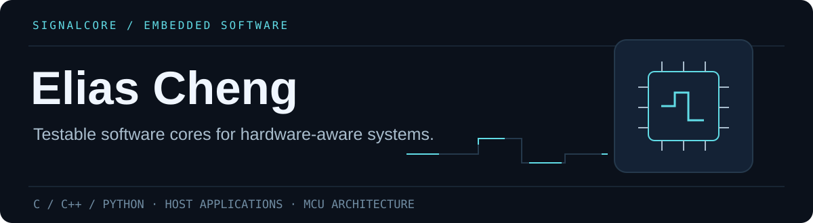
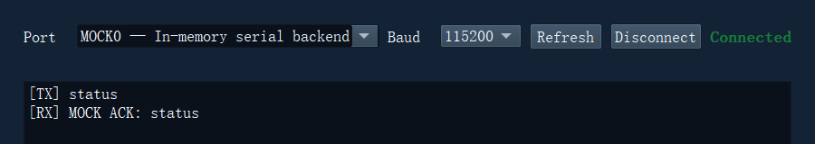
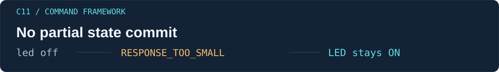
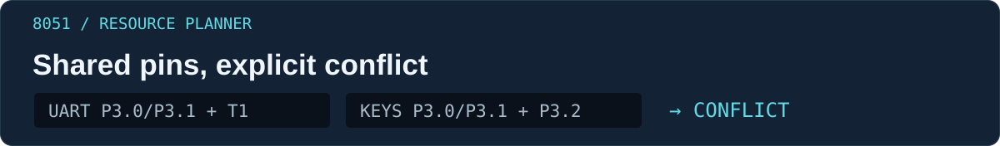
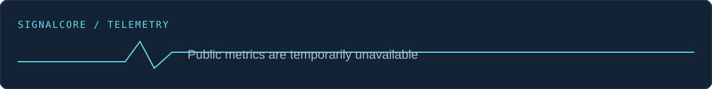

<picture>
  <source media="(max-width: 900px) and (prefers-reduced-motion: reduce) and (prefers-color-scheme: dark)" srcset="assets/brand/hero-mobile-static-dark.svg">
  <source media="(max-width: 900px) and (prefers-reduced-motion: reduce) and (prefers-color-scheme: light)" srcset="assets/brand/hero-mobile-static-light.svg">
  <source media="(max-width: 900px) and (prefers-color-scheme: dark)" srcset="assets/brand/hero-mobile-dark.svg">
  <source media="(max-width: 900px) and (prefers-color-scheme: light)" srcset="assets/brand/hero-mobile-light.svg">
  <source media="(prefers-reduced-motion: reduce) and (prefers-color-scheme: dark)" srcset="assets/brand/hero-static.svg">
  <source media="(prefers-reduced-motion: reduce) and (prefers-color-scheme: light)" srcset="assets/brand/hero-static-light.svg">
  <source media="(prefers-color-scheme: dark)" srcset="assets/brand/hero-dark.svg">
  <source media="(prefers-color-scheme: light)" srcset="assets/brand/hero-light.svg">
  
</picture>

Open a project to inspect its implementation, host tests and target limits.

## Selected engineering

### [Python Host Application](https://github.com/REliasCheng/Python-Host-Application-Lab)

<picture>
  <source media="(max-width: 900px) and (prefers-color-scheme: dark)" srcset="assets/cards/featured-python-mobile-dark.svg">
  <source media="(max-width: 900px) and (prefers-color-scheme: light)" srcset="assets/cards/featured-python-mobile-light.svg">
  <source media="(prefers-color-scheme: dark)" srcset="assets/evidence/python-host-mock-gui-dark.png">
  <source media="(prefers-color-scheme: light)" srcset="assets/evidence/python-host-mock-gui-light.png">
  
</picture>

This real Qt window uses an in-memory serial backend, not a connected device. The serial interface keeps connection and error paths testable without hardware; real-device communication is unverified.

**[View repository →](https://github.com/REliasCheng/Python-Host-Application-Lab)**

[Source](https://github.com/REliasCheng/Python-Host-Application-Lab/blob/main/src/host_app/core/application.py) · [Tests](https://github.com/REliasCheng/Python-Host-Application-Lab/blob/main/tests/test_gui.py) · [CI](https://github.com/REliasCheng/Python-Host-Application-Lab/actions/workflows/test.yml) · [Design](https://github.com/REliasCheng/Python-Host-Application-Lab/blob/main/docs/system-architecture.md)

### [Embedded C/C++ Core](https://github.com/REliasCheng/Embedded-C-Cpp-Learning)

<picture>
  <source media="(max-width: 900px) and (prefers-color-scheme: dark)" srcset="assets/cards/featured-embedded-cpp-mobile-dark.svg">
  <source media="(max-width: 900px) and (prefers-color-scheme: light)" srcset="assets/cards/featured-embedded-cpp-mobile-light.svg">
  <source media="(prefers-color-scheme: dark)" srcset="assets/cards/featured-embedded-cpp-dark.svg">
  <source media="(prefers-color-scheme: light)" srcset="assets/cards/featured-embedded-cpp-light.svg">
  
</picture>

The handler prepares a response before mutating device state; a valid retry can commit after a short-buffer failure. Command, ring-buffer and task modules have host tests, without an MCU target build.

**[View repository →](https://github.com/REliasCheng/Embedded-C-Cpp-Learning)**

[Source](https://github.com/REliasCheng/Embedded-C-Cpp-Learning/blob/main/projects/06_%E7%BB%BC%E5%90%88%E8%BD%AF%E4%BB%B6%E5%AE%9E%E8%B7%B5/%E5%B5%8C%E5%85%A5%E5%BC%8F%E5%91%BD%E4%BB%A4%E5%A4%84%E7%90%86%E6%A1%86%E6%9E%B6/practice/src/command.c) · [Tests](https://github.com/REliasCheng/Embedded-C-Cpp-Learning/blob/main/projects/06_%E7%BB%BC%E5%90%88%E8%BD%AF%E4%BB%B6%E5%AE%9E%E8%B7%B5/%E5%B5%8C%E5%85%A5%E5%BC%8F%E5%91%BD%E4%BB%A4%E5%A4%84%E7%90%86%E6%A1%86%E6%9E%B6/tests/test_command_framework.c) · [CI](https://github.com/REliasCheng/Embedded-C-Cpp-Learning/actions/workflows/host-tests.yml) · [Design](https://github.com/REliasCheng/Embedded-C-Cpp-Learning/blob/main/docs/%E5%B7%A5%E7%A8%8B%E7%BB%93%E6%9E%84%E8%AE%BE%E8%AE%A1.md)

### [C51 Board Resource Planner](https://github.com/REliasCheng/C51-Board-Lab)

<picture>
  <source media="(max-width: 900px) and (prefers-color-scheme: dark)" srcset="assets/cards/featured-c51-mobile-dark.svg">
  <source media="(max-width: 900px) and (prefers-color-scheme: light)" srcset="assets/cards/featured-c51-mobile-light.svg">
  <source media="(prefers-color-scheme: dark)" srcset="assets/cards/featured-c51-dark.svg">
  <source media="(prefers-color-scheme: light)" srcset="assets/cards/featured-c51-light.svg">
  
</picture>

The planner compares declared module resource masks and preserves the existing plan on conflict. GPIO, Timer, UART and I²C mapping and failure paths are host-tested; board wiring and runtime remain unverified.

**[View repository →](https://github.com/REliasCheng/C51-Board-Lab)**

[Source](https://github.com/REliasCheng/C51-Board-Lab/blob/main/projects/06_%E7%BB%BC%E5%90%88%E5%BA%94%E7%94%A8/board-resource-planner/practice/src/board_resources.c) · [Tests](https://github.com/REliasCheng/C51-Board-Lab/blob/main/projects/06_%E7%BB%BC%E5%90%88%E5%BA%94%E7%94%A8/board-resource-planner/tests/test_board_resources.c) · [CI](https://github.com/REliasCheng/C51-Board-Lab/actions/workflows/host-tests.yml) · [Design](https://github.com/REliasCheng/C51-Board-Lab/blob/main/projects/06_%E7%BB%BC%E5%90%88%E5%BA%94%E7%94%A8/board-resource-planner/README.md)

## MCU development

- [STC8 MCU Learning](https://github.com/REliasCheng/STC8-MCU-Learning) — C89 UART RX ring buffer and 8051 adapter; host-tested core, no Keil target or board evidence.
- [STC89C52 Learning](https://github.com/REliasCheng/stc89c52-learning) — RTC, temperature and configuration state behind platform callbacks; host tests, no C51 target or hardware verification.
- [BlueBridgeCup MCU](https://github.com/REliasCheng/BlueBridgeCup-MCU) — CT107D resource, timing and control policies; host tests, no complete target or board validation.

## Architecture and research

Design and study repositories below are not presented as completed firmware or hardware runs.

**Firmware / RTOS / GUI**

- [ARM Cortex-M](https://github.com/REliasCheng/ARM-Cortex-M-Development-Lab) — startup, interrupts, clocks and driver layering.
- [FreeRTOS](https://github.com/REliasCheng/FreeRTOS-Embedded-Lab) — scheduling, IPC and ISR-to-task design.
- [LVGL Embedded GUI](https://github.com/REliasCheng/LVGL-Embedded-GUI-Lab) — display, input, rendering and event pipeline.

**Connectivity / OTA**

- [Wireless / IoT](https://github.com/REliasCheng/Wireless-IoT-Embedded-Lab) — Wi-Fi → lwIP → TCP → plain MQTT model; no TLS or live sensor evidence.
- [Firmware Update / OTA](https://github.com/REliasCheng/Embedded-OTA-Update-Lab) — bootloader, UART/YMODEM, MQTT and CRC boundary model; no A/B or rollback claim.

**Robotics / Linux / foundations**

- [Embodied Robotics Arm](https://github.com/REliasCheng/Embodied-Robotics-Arm-Lab) — LeRobot integration study with third-party code; no functional or hardware run claimed.
- [ARM Embedded Linux](https://github.com/REliasCheng/ARM-Linux-Embedded-Lab) — RK3566 boot, Device Tree and driver-interface research; no public kernel build or board runtime claimed.
- [Embedded Systems Foundations](https://github.com/REliasCheng/Embedded-Systems-Foundations) — electronics, logic, CPU, MCU and PCB knowledge map; documentation, not runnable firmware.

## Public engineering evidence

View dated public metrics and five selected host CI checks

Statuses are matched to each repository's `main` SHA at the displayed refresh time. `PASS` means host CI only, never target or hardware validation; API failures remain `UNAVAILABLE`.

<picture>
  <source media="(prefers-color-scheme: dark)" srcset="https://raw.githubusercontent.com/REliasCheng/REliasCheng/signalcore-assets/telemetry-dark.svg">
  <source media="(prefers-color-scheme: light)" srcset="https://raw.githubusercontent.com/REliasCheng/REliasCheng/signalcore-assets/telemetry-light.svg">
  
</picture>

[Open full-size dark metrics](https://raw.githubusercontent.com/REliasCheng/REliasCheng/signalcore-assets/telemetry-dark.svg) · [Open full-size light metrics](https://raw.githubusercontent.com/REliasCheng/REliasCheng/signalcore-assets/telemetry-light.svg)

---

**SIGNALCORE** · [About this portfolio](docs/maintenance.md)

Original profile content follows this repository's [LICENSE](LICENSE). Linked projects, vendor material and dependencies retain their own terms.
